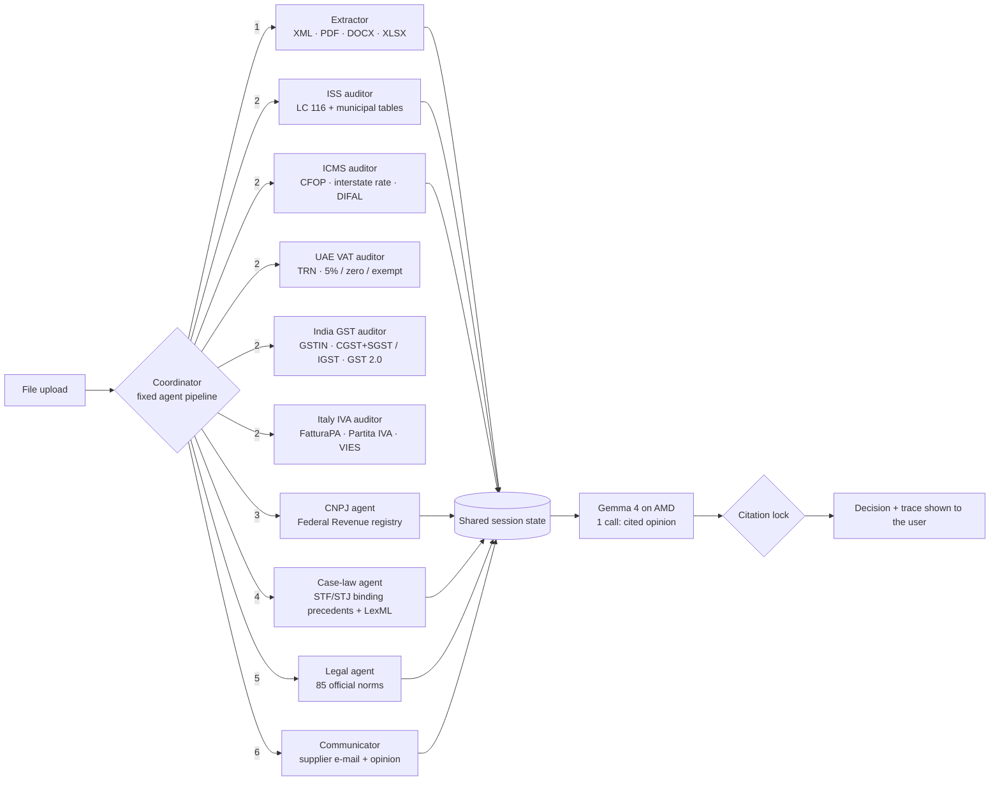

# Vyson Calc & Negócios · Vyson Auditor

**A team of AI agents that audits invoices from Brazil, Dubai (UAE VAT) and India (GST), answers SAP Ariba sourcing events and prepares public-tender paperwork, citing the law for every decision.**

Video (4 min 28 s): **https://youtu.be/PRp9gXab_QQ** · Slides: [English](docs/Vyson_Calc_Negocios_Presentation_EN.pdf) · [Português](docs/Vyson_Calc_Negocios_Apresentacao_PT.pdf)

Live demo: **https://tatianabot-dashboard.vercel.app/fiscal/auditor**
(click "Usar notas de exemplo" → "Auditar" and open "Como os agentes trabalharam" to watch the agents plan and act)

Built by Tatiana Tenório Martins: Brazilian accountant and court-appointed expert, specialist in Tax Law and Judicial Calculations, 4+ years at the Court of Justice of the State of Alagoas, TJAL (trained the team that cleared its calculation backlog in 2025), Software Engineering student, to solve a daily problem: every company in Brazil receives hundreds of invoices a month from 5,570 municipalities, each with its own service-tax (ISS) rates and codes. Errors become fines, and checking them by hand takes hours.

## Real-world validation

- **2 public tenders won and awarded in Brazil (R$ 2.36 million in contracts)** using the method behind the tender agent: reading the notice, building the qualification package with the legal basis of each document, checking every certificate's validity on the session date, and pricing with the right taxes. Client and agency names are not published (professional secrecy).
- Real service invoices from Maceió audited end to end on the live site, with Gemma 4 on AMD coordinating six agents (client data not published).

## What it does

| Workflow | Input | What the agents do | Output |
|---|---|---|---|
| **Invoice audit** | Brazil: NFS-e (XML, PDF, Word) or NF-e/DANFE (XML) · UAE: e-invoice UBL/PINT AE (XML) · India: GST e-invoice (IRP JSON) · or a .zip with hundreds of them | Read the invoice, check tax code, municipal rate, tax amount, withholdings, supplier CNPJ, binding court precedents | Decision (approve / review / return to supplier), findings with legal source, e-mail to the supplier |
| **SAP Ariba event** | RFQ/RFP exported from Ariba (Excel, PDF, Word) | Read the items, split goods from services, price each item with the taxes of the bidder's regime, compute buyer withholdings | Priced response sheet ready to upload, net amount to receive |
| **Public tender** | Tender notice (PDF) | Extract requirements and risks, generate the 7 declarations required by Law 14.133/2021 and the commercial proposal, then validate the signed documents | Word documents + checklist of what is missing, expired or inconsistent |

## Multi-agent architecture



- **One model call, not a planning loop.** The specialist agents run in a fixed order as code (extract → audit → CNPJ → case law → legal → communicator), because that order never changes. The open model on AMD (Gemma-4-31B-IT via AMD Token Factory) is called **once**, at the end, to write the opinion from the agents' results. Fewer calls means lower latency and fewer points of failure.
- **Citation lock (anti-hallucination).** Every source the model cites in brackets must exist in the agents' results; a made-up law or article number is rejected and the rules write the opinion instead (`_citacoes_ok` in `agentes/agentes.py`, tested in `tests/test_agentes.py`).
- **Deterministic tools for the facts.** Tax rules run as code over official data, so numbers are reproducible and auditable; the model writes *the explanation*, not *the tax rate*.
- **Graceful fallback.** Without a model key, or if the model is down, the same pipeline runs and the rules write the opinion, so the demo never stops.
- **Full trace.** The UI shows every step ("Coordinator decided to call: ISS auditor → 1 error → Legal agent found LC 116/2003 → Communicator drafted the e-mail").

## UAE (Dubai): why it matters and what the agent checks

**The market.** Every VAT-registered business in the UAE must issue tax invoices that meet Executive Regulation art. 59, and e-invoicing in the PINT AE (Peppol) format is becoming mandatory: pilot from 1 July 2026, businesses with revenue of AED 50 million or more from 1 January 2027, all other businesses from 1 July 2027 (Ministerial Decision 244/2025). Invoices issued without the legal requirements can lead to FTA administrative penalties (Cabinet Decision 49/2021). Companies will need to check thousands of e-invoices before they reach the VAT return.

**What the UAE auditor checks (fictitious samples in `web/exemplos/fatura_dubai_*.xml`):**

| Check | Legal basis |
|---|---|
| Supplier and customer TRN (15 digits, starting with 100) | FTA |
| "Tax Invoice" title, supplier address, invoice number and date | Executive Regulation, art. 59(1) |
| Each line: description, quantity × unit price = line amount | Executive Regulation, art. 59(1)(f)-(i) |
| VAT category (S 5%, Z zero-rated, E exempt, O out of scope, AE reverse charge) and VAT amount in AED | Decree-Law 8/2017, arts. 3, 45, 46, 48 |
| Reverse charge must be stated on the invoice | Executive Regulation, art. 59(1)(l) |
| Invoice issued within 14 days of supply | Decree-Law 8/2017, art. 67 |
| Simplified tax invoice allowed up to AED 10,000 for unregistered customers | Executive Regulation, art. 60 |
| Zero-rated supplies need export evidence | Executive Regulation, art. 30 |
| PINT AE: customization ID, document type, Peppol endpoint IDs | PINT AE (Peppol International) |
| Totals: tax-exclusive + VAT = tax-inclusive | — |

## Beyond Brazil

| Country | What the agent checks | Legal basis |
|---|---|---|
| **UAE (Dubai)** | Supplier/customer TRN format, VAT category and rate (5% standard, zero-rated, exempt), VAT amount, totals, AED amount, mandatory tax-invoice fields, e-invoicing readiness | Federal Decree-Law 8/2017, Executive Regulation art. 59 |
| **India** | GSTIN with checksum, intra-state CGST+SGST vs inter-state IGST, GST 2.0 rates (from 22 Sep 2025), SAC chapter 99 for services, IRN, TDS hint | CGST Act 2017, IGST Act 2017, CGST Rules 46 and 48 |

Adding a country is a new auditor module plus its official table; the coordinator and the other agents stay the same.

## Official data used

| File | Content | Source |
|---|---|---|
| `data/data.json` | National service list (LC 116/2003), NFS-e national codes, IBS/CBS classification | Receita Federal, Annex VIII/VI |
| `data/maceio.json` | 906 municipal ISS codes and rates of Maceió | GISS Online, Maceió City Hall |
| `data/saopaulo.json` | 410 ISS codes of São Paulo | IN SF/SUREM 08/2011 |
| `data/leis.json` | 85 federal norms and court rulings with official links | Planalto, Receita Federal |
| `data/jurisprudencia.json` | 10 binding precedents (STF/STJ) that change how the law applies | STF, STJ |

## What runs on AMD

| Part | Where it runs | Role |
|---|---|---|
| Opinion model (open model, Gemma 4 / Qwen) | AMD Token Factory (AMD GPU) or self-hosted vLLM on ROCm (AMD Developer Cloud) | One call per audit: writes the cited opinion from the agents' results, checked by the citation lock |
| Tax rules, official tables, citation of the law | CPU (deterministic code) | Rates, codes and amounts are computed, never generated |
| Evolus document extractor + human-review workflow | Evolus platform (REST API), connected to our AMD-hosted model | Reads scanned invoices; hands cases with errors to a person, with CNPJ/CPF/names masked and a SHA-256 receipt |

## Related repositories

| Repository | What it is |
|---|---|
| [vyson-auditor](https://github.com/tatianamartins-VYSON/vyson-auditor) (this one) | The agent team: invoice audit, Evolus extractor + human-review workflow, tenders, SAP Ariba |
| [vyson-fiscalrag](https://github.com/tatianamartins-VYSON/vyson-fiscalrag) | Cited tax Q&A on AMD (vLLM/ROCm), deterministic citation gate, frozen 30-question evaluation with SHA-256, tests and CI |

### Measured on AMD (live site, 17 Oct 2026)

**Gemma-4-31B-IT** served on AMD infrastructure (AMD Token Factory):

| Test | Result |
|---|---|
| Question "minimum ISS rate under LC 116?" (`/api/fiscal_ask`) | answer in ~12 s; search across 1,533 official sources in 0.005 s |
| Citation lock | the model wrote "2% (art. 8º-A)" without a source in that sentence; the lock rejected it and showed only the official source (LC 157/2016, Planalto link) |
| Invoice audit (`/api/auditor`) | agents run as code; the model is called once for the opinion |
| Evolus agents (`/api/auditor?evolus=1&teste=1` and `&teste=processo`) | invoice extractor and court-case extractor return JSON (HTTP 200) |

Earlier version (16 Oct) used a planning loop with 4 model calls (1.4 to 3.4 s each, ≈10 s); it was replaced by the single call above.

The site shows every step and the time of each model call under "Como os agentes trabalharam".

## Run it

```bash
pip install -r requirements.txt
cp .env.example .env        # put your Google AI Studio key in LLM_API_KEY
export $(grep -v '^#' .env | xargs)
python web/servidor.py      # http://localhost:8793 → "Usar notas de exemplo" → "Auditar"
                            # http://localhost:8793/perito → court expert batch ("Ver exemplo" → "Analisar em lote")
python tests/test_agentes.py
```

The opinion model works with any OpenAI-compatible endpoint:

| Model | `LLM_BASE_URL` | `LLM_MODEL` |
|---|---|---|
| **Gemini** (default) | `https://generativelanguage.googleapis.com/v1beta/openai` | `gemini-3-flash-preview` |
| AMD Token Factory | `https://developer.amd.com.cn/radeon/api/v1` | `Gemma-4-31B-IT` |
| Self-hosted vLLM | `http://your-server:8000/v1` | your model |

`api/auditor.py` is the same service as a serverless function (Vercel), reading `GEMINI_API_KEY`, `GEMINI_MODEL` and `GEMINI_BASE_URL`.

## Repository layout

```
agentes/   coordinator and agents (agentes.py), tax rules (auditar.py, nfe.py), UAE/India/Italy
           auditors (internacional.py), Evolus extractors (evolus.py), batch audit (lote.py),
           readers (extrair.py), SAP Ariba agent (ariba.py), tender agent (edital.py)
data/      official tables and norms
web/       local web app (servidor.py + ui.html), court expert batch (perito/) and fictitious sample files
api/       serverless version
tests/     end-to-end tests with the sample files
```

## Privacy

Files are processed in memory and not stored. Sample files are fictitious. API keys live only in environment variables.

## Disclaimer

Reference tool for tax professionals. It does not replace the analysis of an accountant; always check the cited norm.

License: MIT · Vyson Fyconsult
